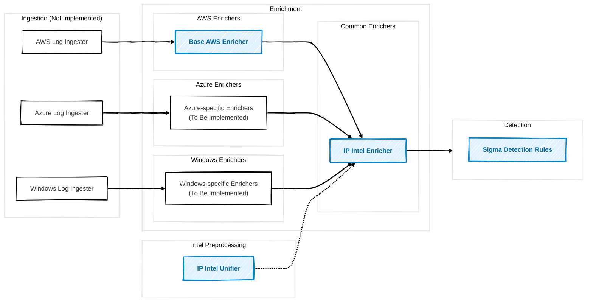

# kirkos

**kirkos** is a proof-of-concept detection pipeline utilising [Vector](https://vector.dev/) for routing logs from different sources to detection rule engines. 

## Detection Pipeline

Below is a high-level view of the pipeline. Clicking on implemented nodes will direct you to the relevant repo. 

